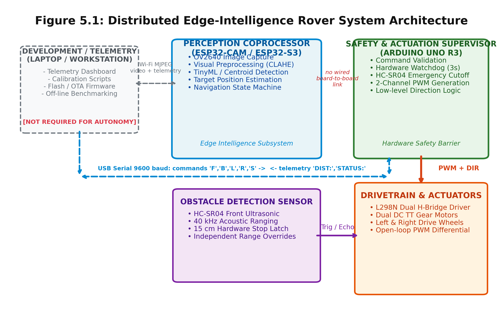
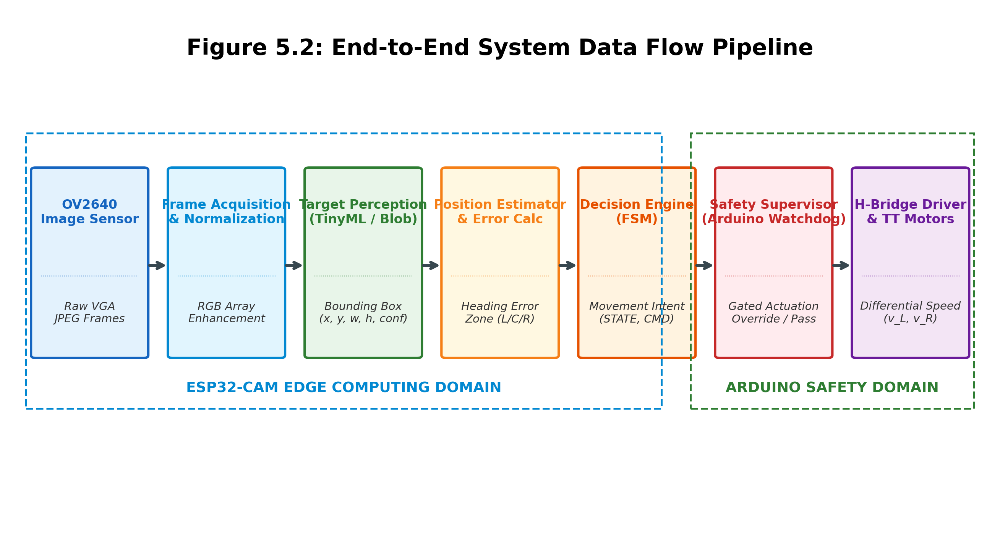

# 07. System Architecture

**Document ID:** DOC-ARCH-001  
**Companion Diagram:** [`figures/01_system_architecture.png`](../figures/01_system_architecture.png) | [`figures/02_data_flow.png`](../figures/02_data_flow.png)

## 1. Architectural Overview

The system architecture partitions the autonomous rover into three isolated functional domains:
1. **The Edge Perception Domain (ESP32-CAM):** Captures high-frequency sensory input, executes contrast enhancement and detection algorithms, and computes spatial errors.
2. **The Supervisory & Safety Domain (Arduino UNO):** Governs physical safety, sensor bounds checking, communication heartbeats, and motor driver gating.
3. **The Power & Actuation Domain (L298N + DC Motors):** Delivers modulated battery power to the mechanical drive wheels.

## 2. Data Flow Architecture

The closed-loop data pipeline follows a strict unidirectional decision cycle with feedback telemetry:
`CAPTURE -> ENHANCE -> INFER -> LOCALIZE -> DECIDE -> VALIDATE -> ACTUATE -> TELEMETRY`

