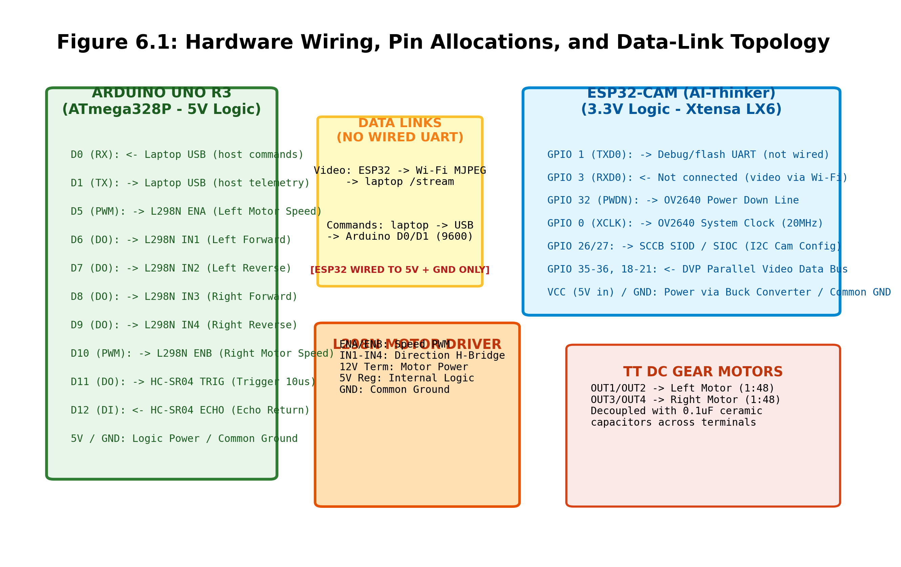

# 08. Hardware Architecture

**Document ID:** DOC-HW-005  
**Companion Diagrams:** [`figures/03_hardware_architecture.png`](../figures/03_hardware_architecture.png) | [`figures/circuit_diagram.png`](../figures/circuit_diagram.png)

## 1. Physical Hardware Components

The rover hardware architecture integrates:
- **Processor A (Perception):** AI-Thinker ESP32-CAM (240 MHz dual-core Xtensa LX6, 4MB external PSRAM, OV2640 2MP sensor).
- **Processor B (Control):** Arduino UNO R3 (16 MHz ATmega328P, 2KB SRAM, 32KB Flash).
- **Interconnect:** ESP32-CAM wired for **power only** (5V + GND); video goes to the laptop as Wi-Fi MJPEG, and the laptop drives the Arduino over USB serial (9600 baud). No level shifter is required or fitted.
- **Driver:** STMicroelectronics L298N dual full-bridge H-bridge driver with thermal heatsink.
- **Ranging Sensor:** HC-SR04 40 kHz ultrasonic acoustic transceiver mounted centrally at the front bumper.
- **Motors:** Dual yellow TT permanent-magnet DC gear motors with 1:48 internal spur gear reduction.
- **Wheels:** 65 mm diameter wheels with textured rubber tread.

