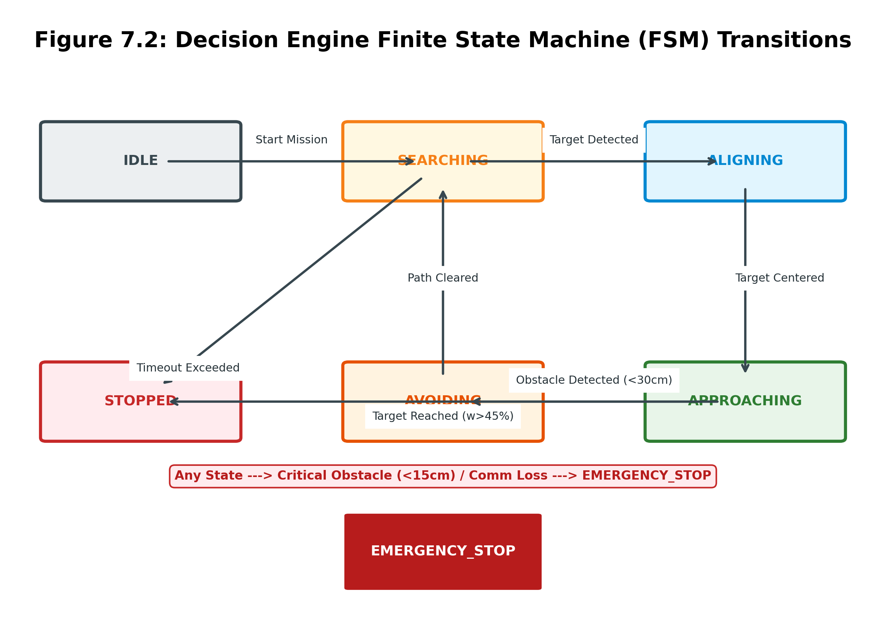

# 09. Software Architecture

**Document ID:** DOC-SW-001  
**Companion Diagrams:** [`figures/07_arduino_pipeline.png`](../figures/07_arduino_pipeline.png) | [`figures/09_state_machine.png`](../figures/09_state_machine.png)

## 1. Software Subsystems & Separation of Concerns

The rover software stack is modularized into four clear layers:
1. **Driver & Hardware Abstraction Layer (HAL):** Non-blocking GPIO manipulation, hardware PWM timer setup, and UART ring buffers on the Arduino UNO.
2. **Perception Engine:** Frame buffer acquisition, CLAHE contrast adjustment, and normalized bounding box calculation on the ESP32.
3. **Decision & Navigation FSM:** State transitions governing mission phases (`IDLE`, `SEARCHING`, `ALIGNING`, `APPROACHING`, `AVOIDING`, `STOPPED`).
4. **Supervisory Safety Manager:** Deterministic multi-priority latch that gates or suppresses actuation commands.

