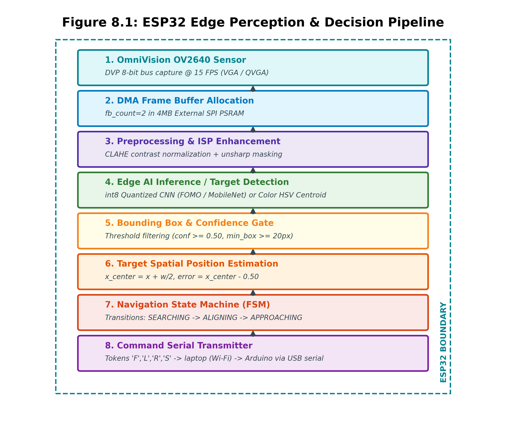

# 10. ESP32 AI & Edge Perception Pipeline

**Document ID:** DOC-AI-002  
**Companion Diagram:** [`figures/05_esp32_pipeline.png`](../figures/05_esp32_pipeline.png)

## 1. Pipeline Stages

The ESP32 perception pipeline executes the following deterministic stages on every loop iteration:
1. **DVP Frame Acquisition:** OmniVision OV2640 sensor streams parallel 8-bit YUV/RGB/JPEG data via DMA into external PSRAM frame buffers (`fb_count = 2`).
2. **Image Preprocessing:** Contrast-Limited Adaptive Histogram Equalization (CLAHE) normalizes fluctuating indoor illumination. Unsharp masking accentuates edge gradients.
3. **Target Inference:** Executes quantized TinyML inference (Edge Impulse FOMO or MobileNetV1 int8) or color centroid calculation.
4. **Confidence Gating:** Discards detections with confidence $< 0.50$ or bounding box width $< 20$ pixels.
5. **Spatial Heading Error Extraction:** Computes normalized horizontal target center $x_{center} = x + w/2$ and error $e = x_{center} - 0.50$.
6. **Command Dispatch:** Emits ASCII motion tokens ('F','L','R','S') toward the laptop (Wi-Fi); the laptop relays them to the Arduino over USB serial - there is no direct ESP32-to-Arduino wire.

