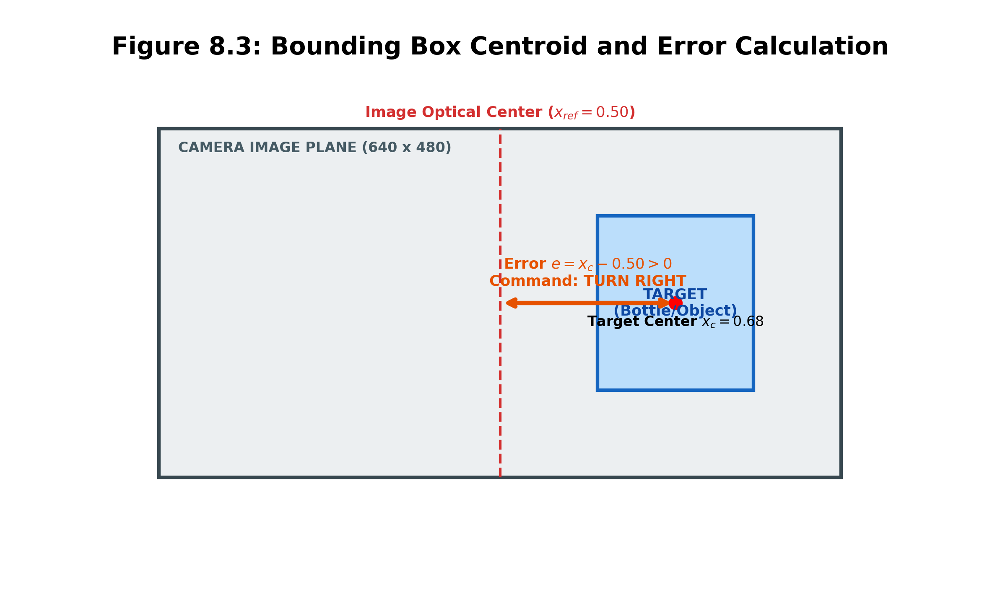

# 12. Visual Target Detection & Position Estimation

**Document ID:** DOC-AI-003  
**Companion Diagrams:** [`figures/12_target_position.png`](../figures/12_target_position.png) | [`figures/13_left_center_right_zones.png`](../figures/13_left_center_right_zones.png)

## 1. Target Spatial Coordinate Estimation

The camera coordinates are normalized to the unit interval $[0.0, 1.0]$ across width $W_{frame}$ and height $H_{frame}$:
$$x_{center} = x_{bbox} + \frac{w_{bbox}}{2}$$
$$y_{center} = y_{bbox} + \frac{h_{bbox}}{2}$$

Heading error $e$ relative to the optical axis is defined as:
$$e = x_{center} - 0.50$$

```
+--------------------------------------------------------------+
| LEFT ZONE         |        CENTER ZONE        |   RIGHT ZONE |
| [0.00, 0.33)      |        [0.33, 0.66]       | (0.66, 1.00] |
|                   |     <- Deadband (±0.06)-> |              |
|                   |                           |    [TARGET]  |
|                   |             + Optical Axis|       x_c    |
|                   |             |             |<-- e > 0 --->|
+--------------------------------------------------------------+
```


