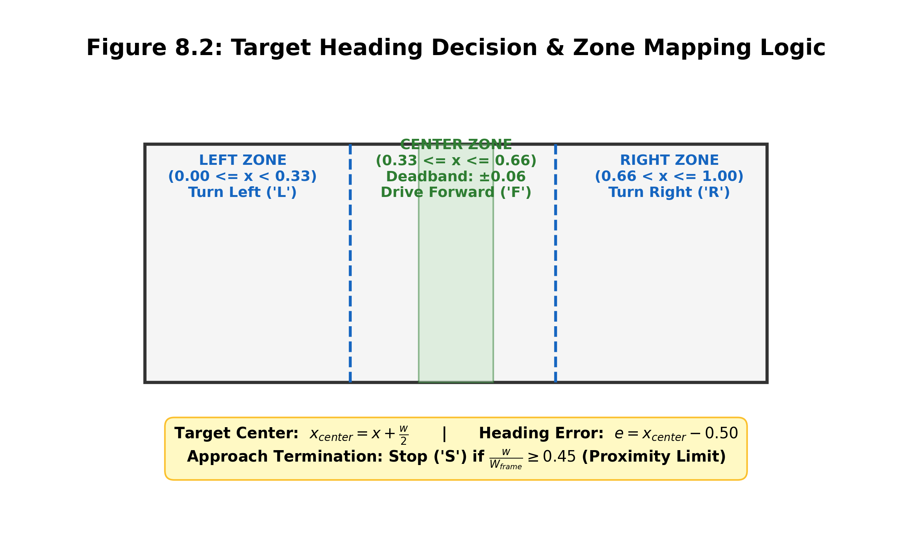

# 13. Decision Engine & Anti-Oscillation Logic

**Document ID:** DOC-NAV-001  
**Companion Diagram:** [`figures/06_decision_pipeline.png`](../figures/06_decision_pipeline.png)

## 1. Anti-Oscillation Deadband & State Latching

To prevent rapid chattering (limit cycles) when the target is near the zone boundary:
1. **Center Tolerance Deadband:** A tolerance window $\delta = \pm 0.06$ surrounds the optical center ($[0.44, 0.56]$). While the target error $|e| \le \delta$, the vehicle commands forward translation ('F').
2. **Minimum Command Duration:** Once a steering command ('L' or 'R') is issued, the state machine holds the command for $t_{min} = 0.40$ s before permitting state re-evaluation.
3. **Decision Cooldown:** A $0.20$ s refractory period prevents instantaneous switching on noisy single-frame misdetections.
4. **Proximity Termination:** When the bounding box width ratio reaches:
$$\frac{w_{bbox}}{W_{frame}} \ge 0.45$$
the rover infers that it has successfully arrived at the target ($~20$ cm standoff) and transitions to `STOPPED`.

