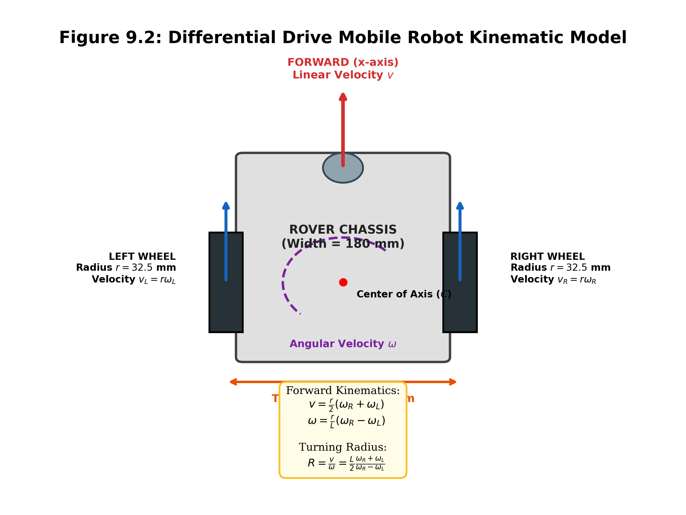

# 14. Differential Drive Kinematics & Physical Dynamics

**Document ID:** DOC-PHY-001  
**Companion Diagram:** [`figures/11_differential_drive_geometry.png`](../figures/11_differential_drive_geometry.png)

## 1. Kinematic Equations of Motion

Consider a two-wheeled differential drive mobile robot with wheel radius $r = 0.0325$ m and track width $L = 0.180$ m:

```
        FRONT (x-axis)
             ^
             | v
   [L-WHEEL] | [R-WHEEL]
     v_L     |   v_R
       <---- L ---->
```

The forward kinematic equations mapping wheel angular velocities $(\omega_L, \omega_R)$ to robot linear velocity $v$ and angular velocity $\omega$ are:
$$v = \frac{r}{2} (\omega_R + \omega_L)$$
$$\omega = \frac{r}{L} (\omega_R - \omega_L)$$

Inverted Kinematics (Actuator Setpoints):
$$\omega_R = \frac{2v + \omega L}{2r}$$
$$\omega_L = \frac{2v - \omega L}{2r}$$

Instantaneous Center of Curvature (ICC) radius $R$:
$$R = \frac{v}{\omega} = \frac{L}{2} \left( \frac{\omega_R + \omega_L}{\omega_R - \omega_L} \right)$$



## 2. Friction, Wheel Slip, and Motor Asymmetry

- **Slip Assumption:** The kinematic equations assume pure rolling contact without longitudinal slip or lateral skid (`[ASSUMPTION]`).
- **Motor Mismatch:** In low-cost DC gear motors, torque variations of 5-10% are typical due to brush friction and magnetic variance. Open-loop rovers will curve during forward motion; the closed-loop visual tracking loop automatically compensates by dynamically trimming heading.
