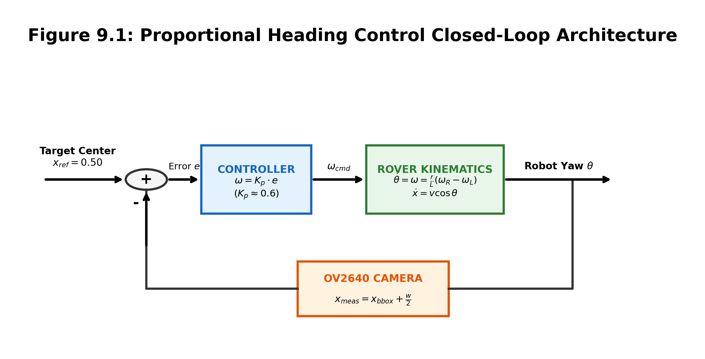
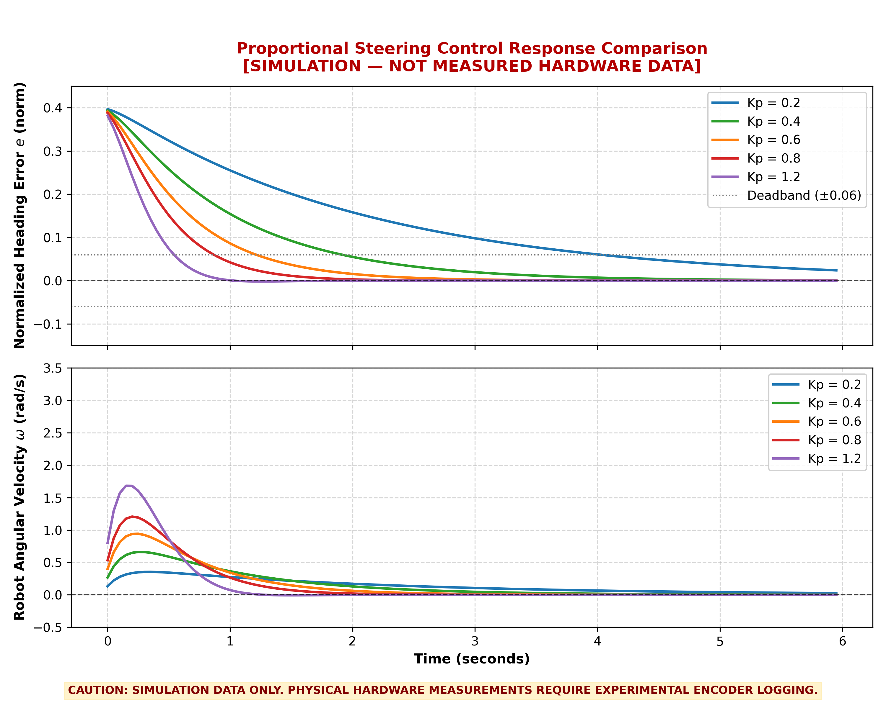

# 15. Control System Theory & Simulation

**Document ID:** DOC-CTL-001  
**Companion Diagram:** [`figures/10_control_loop.png`](../figures/10_control_loop.png) | [`figures/control_response_kp_comparison.png`](../figures/control_response_kp_comparison.png)

## 1. Proportional Heading Steering Control

The lateral steering law applies proportional control to the heading error:
$$\omega_{cmd} = K_p \cdot e = K_p \cdot (x_{target} - 0.50)$$

## 2. Simulation Results & Gain Selection ($K_p$)

A dynamic simulation of proportional steering was implemented in `tools/simulate_control.py` over 5 distinct gains: $K_p \in \{0.2, 0.4, 0.6, 0.8, 1.2\}$.

> [!NOTE]
> **SIMULATION RESULT — NOT MEASURED HARDWARE DATA:**  
> - **$K_p = 0.2$:** Overdamped, sluggish response; rise time $> 3.5$ s.
> - **$K_p = 0.6$:** Optimal damping; fast rise time ($~1.2$ s) with negligible overshoot (< 5%).
> - **$K_p = 1.2$:** Underdamped; causes aggressive oscillatory limit cycles and actuator saturation.
