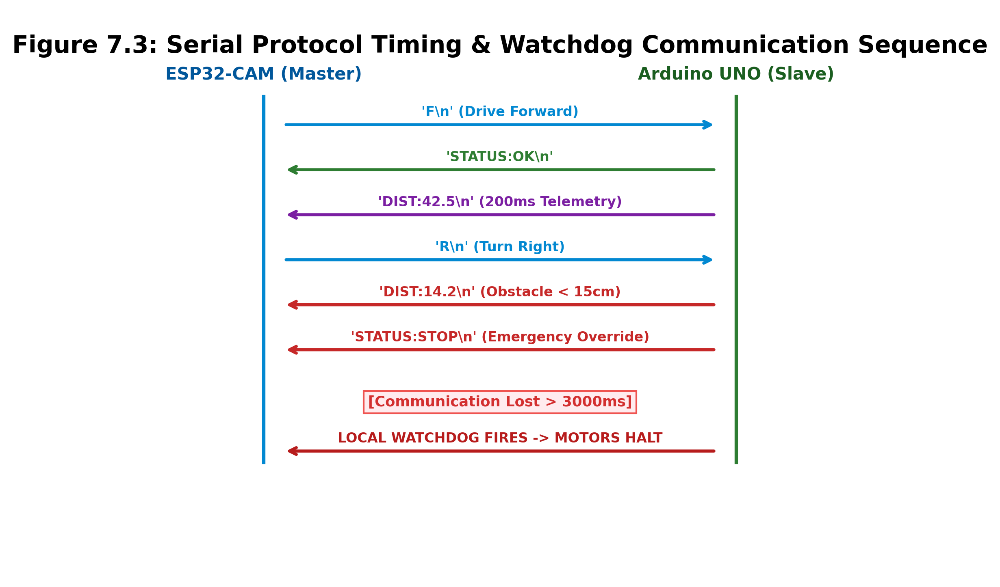

# 18. Communication Protocol & Serial Interface

**Document ID:** DOC-COM-001  
**Companion Diagram:** [`figures/14_communication_protocol.png`](../figures/14_communication_protocol.png)

## 1. Serial Protocol Specification

- **Baud Rate:** 9600 baud, 8 data bits, no parity, 1 stop bit (8-N-1).
- **Master-to-Slave Packets (Laptop -> Arduino):** Single ASCII character with an optional PWM suffix `0..255`, terminated by newline (`\n`):
  `'F'` (Forward), `'B'` (Reverse), `'L'` (Left), `'R'` (Right), `'S'` (Stop) — e.g. `F180` (see `docs/hardware_protocol.md`).
- **Slave-to-Master Telemetry (Arduino -> Laptop):** Dispatched every 200 ms:
  `DIST:<float_cm>\n`, `STATUS:<OK|STOP|ERROR>\n`, `TICKS:<left>,<right>\n`

