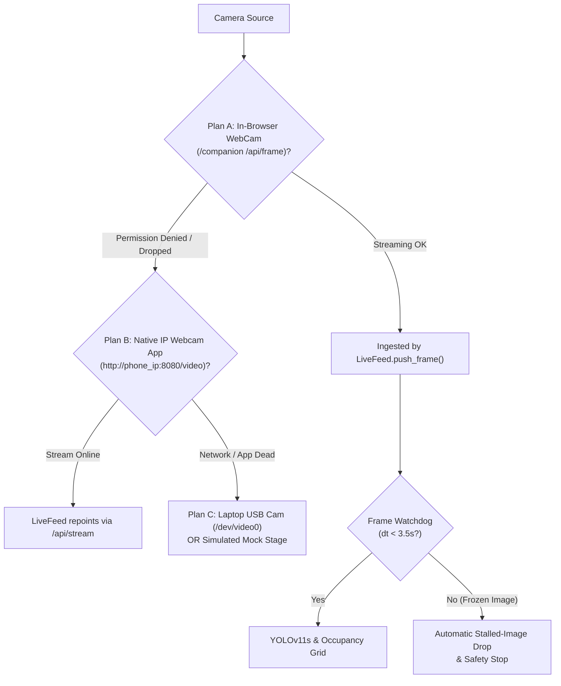
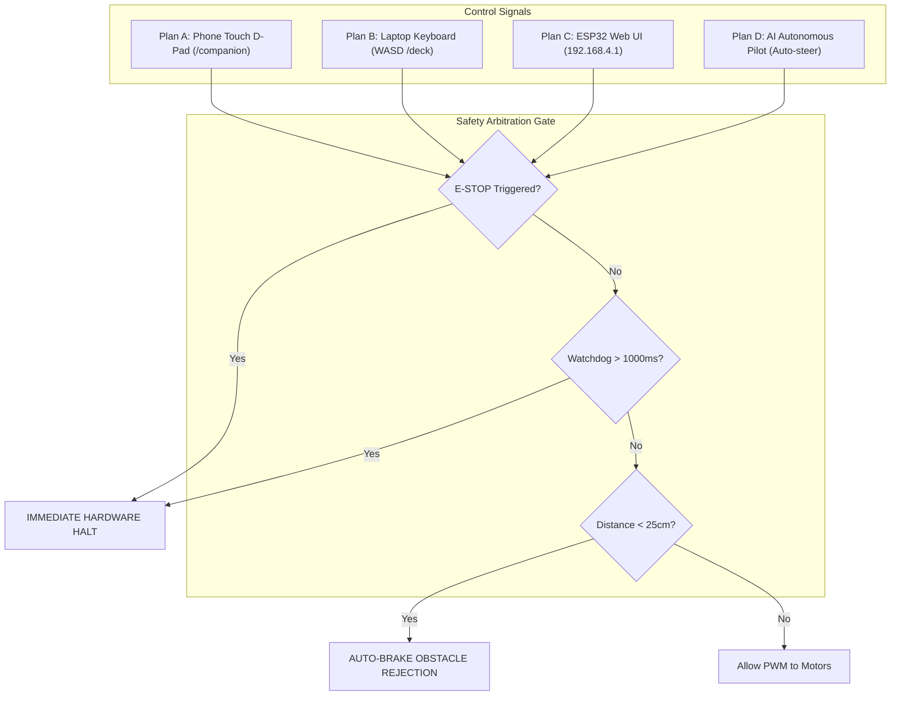

# AI Rover Multi-Tiered Failover & Redundancy Architecture

This document defines the **Plan A**, **Plan B**, and **Plan C** failover specifications across all four mission-critical subsystems: Video Streaming, Network Communications, Driving & Steering, and AI Perception.

---

## 📊 High-Level Redundancy Matrix

| Subsystem | Plan A (Primary) | Plan B (Secondary Backup) | Plan C (Tertiary Failsafe) |
| :--- | :--- | :--- | :--- |
| **1. Video Transmission** | In-Browser WebCam Frame Push (`/api/frame`) | Standalone IP Webcam App Stream (`:8080/video`) | Laptop Local Webcam (`/dev/video0`) or Synthetic Mock Standby |
| **2. Network & Connectivity** | Local Wi-Fi Router LAN (`192.168.1.x`) | Phone Personal Hotspot (`192.168.43.x`) | ESP32 Standalone Soft-AP (`192.168.4.1`) / Direct USB Tether |
| **3. Driving & Steering** | Mobile Touch D-Pad (`/companion` or APK) | Laptop Mission Control Keyboard (`WASD` on `/deck`) | ESP32 Flash Direct Web UI (`:80/web_ui`) / Hardware Ultrasonic Reflex |
| **4. AI Perception & Vision** | YOLOv11s Deep Neural Object Detector | Edge Perception / HSV Color Blob Fallback | Blind Sonar Reactive Obstacle Reflex (`HC-SR04`) |

---

## 📷 Subsystem 1: Video & Vision Stream Failover

### Plan A: In-Browser Camera Push (Turnkey, Zero-Install)
- **Protocol**: HTML5 `getUserMedia` encodes JPEG blobs directly in the phone browser and POSTs them to `/api/frame` at 15 FPS.
- **Failover Trigger**: If camera permissions are denied or phone screen sleeps, the frame watchdog detects $dt \ge 3.5\text{s}$ of silence and discards the frozen frame to prevent blind driving.

### Plan B: Native IP Webcam App (High Performance)
- **Protocol**: Phone runs the dedicated *IP Webcam* app serving an MJPEG stream at `http://<phone_ip>:8080/video`.
- **Activation**: Tap **Plan B (IP Webcam)** on the companion page. It uses the automatically detected phone IP from `/api/state` and instructs the laptop server to pull from the native MJPEG stream.

### Plan C: Laptop Local Camera or Synthetic Mock Perception
- **Protocol**: If the phone is completely unavailable, the dashboard switches to the laptop's built-in webcam (`cv2.VideoCapture(0)`) or the OpenCV synthetic mock stage (`--mock`).

---

## 🌐 Subsystem 2: Network & Communications Redundancy

### Plan A: Local Wi-Fi Router LAN
- All devices (Laptop, Phone, ESP32) connect to the same home or laboratory 2.4 GHz Wi-Fi router.
- **Limitation**: Vulnerable to router-level "Client Isolation" or high channel congestion.

### Plan B: Phone Personal Hotspot (Recommended for Field Tests)
- Enable **Personal Hotspot** on the phone. Connect Laptop and ESP32 to it.
- **Advantages**:
  - Direct 0-hop link with sub-2ms ping.
  - Completely immune to router client isolation.
  - Works anywhere outdoors.

### Plan C: ESP32 Standalone Soft-AP Mode
- The ESP32 Dev gateway broadcasts its own Wi-Fi Access Point:
  - **SSID**: `AI_Rover_Control`
  - **IP**: `192.168.4.1`
- Phone and laptop connect directly to the ESP32 without any router or cellular data.

### Plan D: Direct USB Serial Tether (Ultimate Failsafe)
- Laptop plugs directly into Arduino UNO via USB cable (`/dev/ttyACM0` or `/dev/ttyUSB0`).
- Completely immune to all radio frequency (RF) interference and Wi-Fi dropouts.

---

## 🕹 Subsystem 3: Driving & Control Redundancy

### Safety Override Hierarchy:
1. **Hardware E-Stop (Highest Priority)**: Tapping `STOP` on the phone or pressing `Spacebar` on the laptop immediately zeroes motor PWM, overriding any autonomous driving.
2. **Watchdog Heartbeat Timeout**: If communication drops for $> 1,000\text{ ms}$, the Arduino automatically disengages motor drivers.
3. **Hardware Ultrasonic Safety Reflex**: If the HC-SR04 measures an obstacle closer than $25\text{ cm}$, the Arduino ignores forward commands (`F`) and allows only reverse (`B`) or pivot turns (`L`, `R`).

---

## 🧠 Subsystem 4: AI Perception & Detection Redundancy

### Plan A: YOLOv11s Neural Detector
- Primary neural inference running on Laptop CPU/GPU with bounding boxes, confidence scoring, and label categorization.

### Plan B: Real-Time Edge Perception & HSV Color-Blob Fallback
- Activated automatically in `software/ai/edge_perception.py`:
  - Applies CLAHE contrast equalization in low-light environments ($< 35$ mean luminance).
  - Uses HSV color thresholding to detect vibrant obstacles/targets at 60+ FPS with zero GPU/model overhead.

### Plan C: Sonar Reactive Arc Avoidance
- If camera vision is completely lost, the rover falls back to the Bayesian 2D occupancy grid populated purely by the HC-SR04 sonar sweep.
