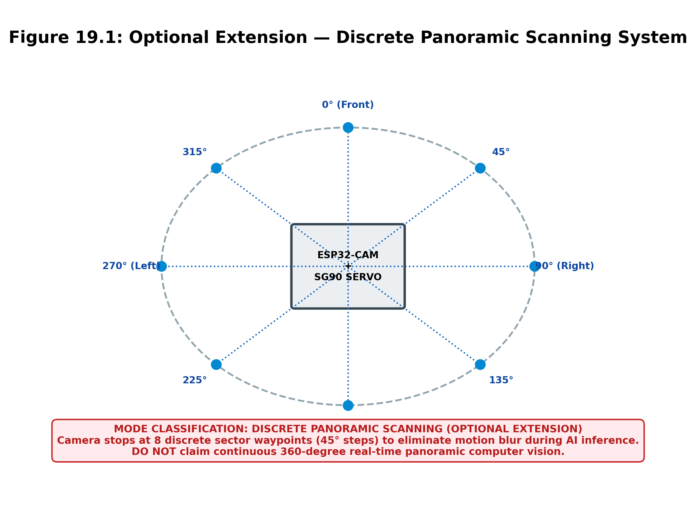

# 30. Future Work & Architectural Extensions

**Document ID:** DOC-FUT-001  
**Companion Diagram:** [`figures/360_degree_scan_diagram.png`](../../figures/360_degree_scan_diagram.png)

> Consolidated home for all future-work material (sections moved here from
> README §19, FINAL_AUDIT and INTEGRATION_PLAN Phase 9+).

## 1. Planned Enhancements

1. **Closed-Loop Wheel Odometry** — *(STARTED 2026-09-25, software landed — see §2; encoder hardware still pending)* Install dual optical disc wheel encoders (connected to Arduino external interrupt pins D2 and D3) with a PID velocity loop to enforce dead-straight tracking.
2. **Discrete Panoramic Scanning (Phase 19 Extension):** Mount the ESP32-CAM on a TowerPro SG90 micro-servo to sweep 8 discrete angular waypoints ($0^\circ, 45^\circ, \dots, 315^\circ$) while stationary, avoiding motion blur. *(NOT STARTED — servo not purchased.)*
3. **Inverted Pendulum Self-Balancing (Phase 20 Study):** Investigate two-wheeled dynamic self-balancing using an MPU-6050 6-DOF IMU and high-torque NEMA-17 stepper motors. *(Excluded from baseline rover due to mechanical and real-time control complexity; explicitly NOT claimed anywhere.)*
4. **Edge TinyML Deployment:** Port int8 quantized Edge Impulse FOMO models directly to ESP-IDF to achieve on-chip object detection at 5+ FPS without external workstation tethering. *(NOT STARTED.)*

## 2. Started 2026-09-25 — closed-loop odometry foundation

Software landed (labels: SIMULATED / MEASURED as noted; no encoder hardware
yet → **HARDWARE REQUIRED** for any physical claim):

- `software/control/pid.py` — PID controller with anti-windup + `pid_from_config` (unit-tested).
- `software/control/odometry.py` — tick→distance math + `odometry_from_config` (unit-tested).
- Firmware `rover_controller.ino` — D2/D3 interrupt tick counting + `TICKS:<l>,<r>` telemetry (inert until encoders are fitted; host-harness scenario `encoders` — SIMULATED).
- `config/config.yaml` `control:` section — gains, PPR, wheel diameter, enable flag; range-validated in `config_loader`.
- Python parser: `Telemetry.encoder_ticks` from `TICKS:` lines (never a heartbeat — red-team M3 preserved).

### Landed 2026-09-25 (Protocol v2 session)

- **Protocol v2 speed channel** — optional PWM suffix `0..255` on
  `F/B/L/R/S` (`F180`); digits never refresh the watchdog; overspeed fails
  safe; `ArduinoSerial.send(cmd, speed=...)` encodes it
  (`docs/hardware_protocol.md`).
- **Firmware P velocity loop** — per-wheel P on `TICKS` deltas while F/B with
  `encodersEnabled`; `VEL_*` consts contract-synced to `control.velocity_*`
  yaml keys; dead-encoder fallback to open-loop (host scenario `velocity`,
  **SIMULATED**).
- **P-steering** — `SceneResult.center_error` → `Decision.speed =
  clamp(round(steering_kp·|err|), steering_min_pwm, 255)` on L/R, appended by
  `main.py` only when the final command matches the steering decision
  (unit-tested; defaults **TUNING REQUIRED**).

**Next:** a measured P-vs-PID comparison (PID only with measured evidence —
MASTER PROMPT §11) once encoders are fitted, plus tuning of `velocity_kp`,
`steering_kp`, `steering_min_pwm` from real ticks.

## 3. Consolidated backlog (from README §19 / FINAL_AUDIT / INTEGRATION_PLAN Phase 9+)

| Item | Notes | Blocker |
|---|---|---|
| Proportional steering (Kp center-error → differential PWM) | **LANDED 2026-09-25** (`Decision.speed` + Protocol v2 suffix; §2) | gain tuning = hardware |
| MPU6050 orientation / IMU-assisted turns | pins A4/A5 free; **not** a self-balancing claim | IMU not purchased |
| Battery telemetry | `BATTERY:` prefix already reserved in the parser | voltage-divider hardware |
| YOLO-small + frame skipping | largely shipped (yolo11s @320, `inference_interval: 2`) | — (done in H4 round) |
| Richer dashboard + dataset eval harness | **eval harness LANDED 2026-09-26** (`scripts/evaluate.py`, 10 invariants, `logs/eval.json` — §5); richer dashboard still open | dashboard = software only |
| L298N → TB6612FNG driver swap | avoids ~2 V drop | hardware swap |
| Edge TinyML / FOMO on ESP32 | see §1.4 | toolchain + board time |
| Self-balancing study | Phase 20; excluded from baseline | out of scope |

## 4. Measurement reality

Nothing above changes the hardware gate: battery + buck still not purchased.
Any closed-loop claim stays **HARDWARE REQUIRED** until encoder ticks come from
real wheels; host-harness results are **SIMULATED** only.

## 5. Landed 2026-09-26 — dataset eval harness

The only backlog row with no hardware blocker. Software evidence, labelled
**ANALYSIS OF LOGGED DATA** (it reads `logs/events.csv`; it never drives the
rover and proves nothing physical):

- `software/telemetry/event_eval.py` — frozen `EventRow`/`EventDataset`,
  strict header validation, per-row defects counted rather than fatal;
  `describe`/`distribution`/`split_runs` statistics and `check_invariants`.
- **10 invariants** derived from `SafetyManager.check` +
  `ObstacleAvoidance.override` (which only downgrades F/B → S) and from how
  `RoverApp.step` fills the log — including *usable distance required for
  translation*.
- Distance cells are classified (`ok / absent / non_finite / negative / zero /
  unparseable`) instead of being silently dropped, so sensor/data defects show
  up in the report.
- `scripts/evaluate.py` — CLI (`--csv/--out/--min-rows/--strict/--json/
  --no-write`), exit `0`/`1`/`2`, writes `logs/eval.json`.
- +33 tests → **232 passed / 0 failed**.

**Next:** the remaining *richer dashboard* row (software only) and, once
hardware exists, using this harness on runs recorded with real sensors.

## 6. Landed 2026-09-26 — multi-object detection accuracy

Software evidence, **MEASURED** against labelled images (offline COCO128, not
this rover's own camera; on-robot confirmation stays **HARDWARE REQUIRED**):

- `software/ai/detection_metrics.py` — pure scoring: IoU, confidence-ordered
  one-to-one matching, precision/recall/F1, **duplicate detections** (a box
  re-reporting an already claimed object), **multi-object recall** (only
  images holding >=2 ground truths) and 101-point interpolated mAP@0.5.
- `scripts/eval_detection.py` — fetches COCO128 (128 labelled images) into
  `datasets/`, scores the shipped detector, and reports latency plus an H4
  closure check; `--set` overrides any config key, `--compare` diffs a baseline.
- Shipped config: `confidence_threshold 0.5→0.25`, `min_box_px 20→8`
  (`yolo_imgsz` held at 320 for the realtime gate) → recall 0.352→0.477,
  multi-object recall 0.347→0.471, F1 0.509→0.601, mAP@0.5 0.618→0.640.
  Latency is load-sensitive: p50 **184 ms at 50 % host CPU load** (0.37 s
  refresh, H4 green) but p50 **534–685 ms at 100 % load** (1.07–1.37 s, H4
  red), so the realtime gate is run with the host at ≤~60 % load. Evidence:
  `logs/detection_baseline.json` vs `logs/detection_final.json`. imgsz 480 was
  measured better (recall 0.559) but breaks the 1.0 s lock on a loaded host
  (p50 577 ms at 100 % CPU), as does 640 (1.33x headroom) — both rejected.
- Model benchmark (5 candidates, same COCO128 set, `reports/MODEL_BENCHMARK.md`):
  shipped `yolo11s` is the most accurate model that meets the realtime gate
  (recall 0.4769 / F1 0.6011 / mAP@0.5 0.640); `RT-DETRv2-R18` reached recall
  0.8827 and mAP@0.5 0.8145 but needs 3427 ms p50 (6.85 s refresh) and
  collapses to precision 0.2828 with 283 duplicates → **rejected, latency-dead
  by 6.8x**. No model change; `yolo26n` recorded as the low-power fallback
  (0.25 s refresh even saturated, −12.3 recall pts).
- Safety split: new `ai.target_confidence: 0.5` keeps `ObjectTracker` target
  selection and the `SafetyManager` forward-motion gate at their pre-change
  value, so the lower detection bar reports more objects without letting the
  rover approach weaker detections. `MockDetector` now anchors to that bar.
- +56 tests → **288 passed / 0 failed**; COCO128 attributed (CC BY 4.0) in
  `THIRD_PARTY.md`; no new Python dependency introduced.

**Next:** capture ground truth from the rover's own camera so this harness can
be re-run on-robot, then the *richer dashboard* row.
