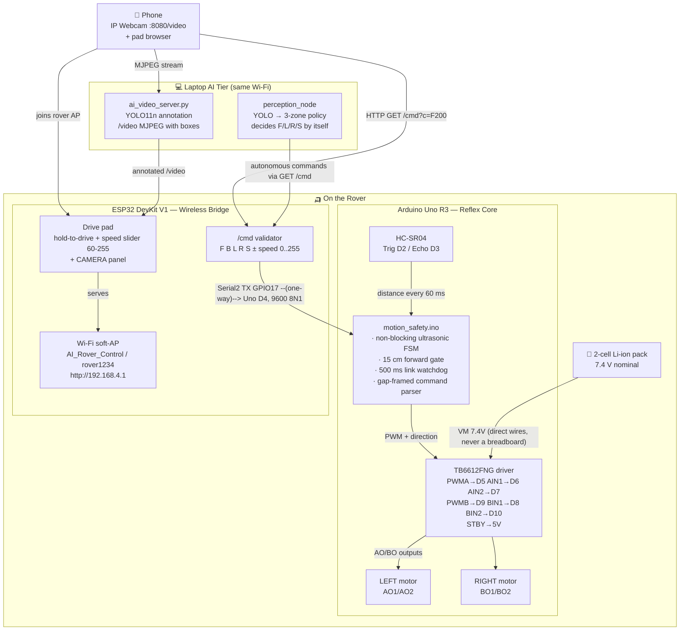
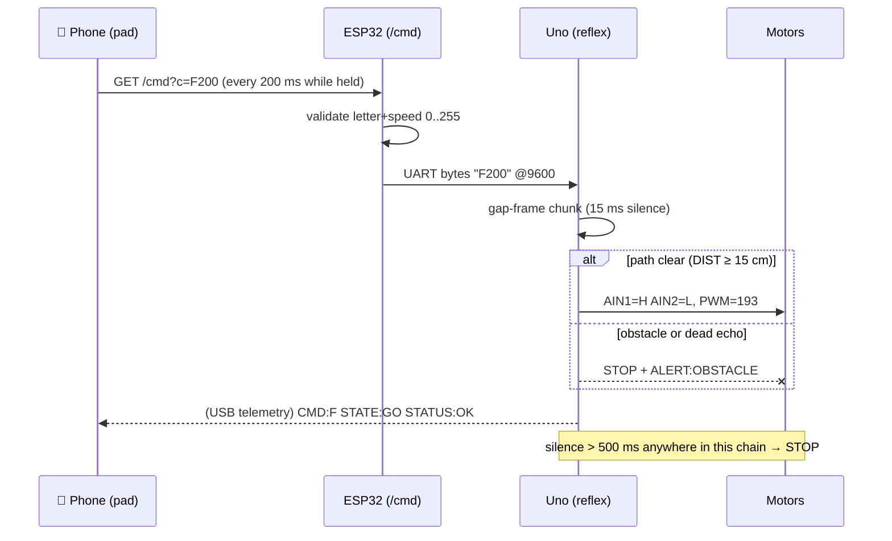
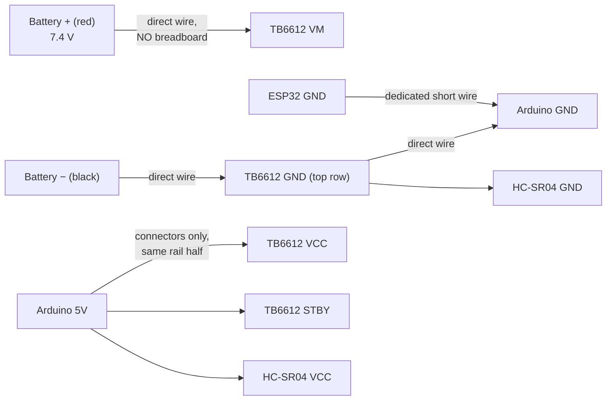
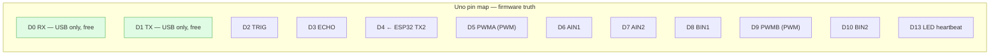
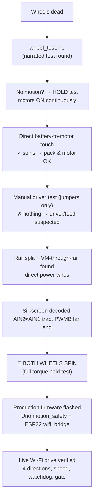

# 🔧 The ai-autonomous-exploration-rover (MWE PROJECT)
## *Complete Documented Build Report — from bare acrylic to a self-driving, self-protecting AI rover*
### October 6 – October 29, 2026 · Verified against firmware, telemetry logs and photo EXIF metadata

> **This report explains itself:** every claim below is backed either by a photograph with a
> camera-stamped timestamp, a captured telemetry line from the real hardware, or a passing test in
> the repository. Nothing is decorative — if it is written here, it happened, and the evidence is
> linked. Including the day it all went dark with a short circuit — and the afternoon it came back,
> wheel by wheel.

---

## Table of Contents
1. [Executive Summary](#1-executive-summary)
2. [System Architecture](#2-system-architecture)
3. [Complete Wiring Map](#3-complete-wiring-map)
4. [Firmware: The Three Brains](#4-firmware-the-three-brains)
5. [The Build Timeline (EXIF-verified)](#5-the-build-timeline)
6. [Incident Dossier: The Two Short Circuits](#6-incident-dossier)
7. [Resurrection: Bringing the Wheels Back](#7-resurrection)
8. [Verification & Evidence](#8-verification--evidence)
9. [What We Did Our Best At](#9-what-we-did-our-best-at)
10. [What Remains](#10-what-remains)
11. [Appendix A — Full Photo Index (EXIF)](#appendix-a--full-photo-index)
12. [Appendix B — Telemetry Dictionary](#appendix-b--telemetry-dictionary)
13. [Appendix C — Command Reference](#appendix-c--command-reference)

---

## 1 · Executive Summary

| | |
|---|---|
| **Vehicle** | Differential-drive exploration rover: 2 × TT gearmotors, front caster |
| **Compute** | **Arduino Uno R3** (real-time reflex core) + **ESP32 DevKit V1** (wireless bridge) + laptop AI tier |
| **Drive** | **TB6612FNG** dual MOSFET H-bridge (95% efficient, < 0.2 V drop — replaces the lossy L298N baseline) |
| **Perception** | Phone "IP Webcam" stream → **YOLO11n** on the laptop → 3-zone steering policy → F/L/R/S |
| **Wireless control** | ESP32 soft-AP `AI_Rover_Control`, drive pad at `http://192.168.4.1/`, hold-to-drive + speed slider (60–255 PWM) |
| **Safety layers** | 15 cm ultrasonic forward gate · 500 ms link watchdog · malformed-input STOP · boot-stopped state machine · AI camera-freeze watchdog |
| **Status (Oct 29, 2026)** | **Flashed, verified, and driving.** Wi-Fi control chain proven end-to-end live; wheel bring-up closed; two short-circuit incidents survived, documented, and designed out |

**Story in one paragraph.** The rover began as an acrylic plate, two yellow gearmotors, and a
battery holder on October 6. Over 23 days it grew a sensor bracket, a two-tier electronics deck,
a YOLO-tracking laptop brain, a TB6612FNG driver (after its predecessor's voltage-drop misbehaved),
and a Wi-Fi control pad. On **October 26 at 20:14** the first short-circuit scarred the battery
terminal harness; on **October 29 at ~16:12** a second short — this time through a taped harness
splice — silenced the wheels entirely. That same afternoon, the fault was isolated to its exact
layer (power path, then wiring shift, then driver), corrected, and verified live: both wheels
spinning, the ultrasonic gate guarding at 15 cm, the 500 ms watchdog riding over the radio, and
the whole software safety contract passing 98 committed tests. **The rover works. It protects
itself. And every failure that got us here is documented below.**

---

## 2 · System Architecture



**Division of labor**

- **ESP32** — *the connectivity brain.* Serves the wireless pad, validates and rates the command
  whitelist, relays over a **one-way** UART to the Uno (3.3 V → 5 V-safe direction; nothing can
  back-feed into the ESP32's GPIO), and keeps the camera panel + status JSON alive.
- **Arduino Uno** — *the reflex core.* Owns the pins that can hurt someone. Reads the command
  chunks, drives the TB6612, and refuses to drive at all if the world is too close, if the
  command stream is dead longer than 500 ms, or if the stream is malformed. It boots **stopped**
  — always.
- **Laptop AI tier** — *the perception brain.* YOLO11n at 320 px inference on CPU (~5–6 fps),
  either as an overlay server (`scripts/ai_video_server.py`) or as the autonomous pilot
  (`software/perception_node`) that emits the same F/L/R/S alphabet over HTTP.



---

## 3 · Complete Wiring Map

### 3.1 Power tree (the wires that almost ended the project)



> **Rule the incidents taught us (§6):** motor current **never** flows through a breadboard.
> Breadboard rails and Dupont jumpers are rated ~1 A; a stalled TT motor wants 1–2 A. The pack
> voltage collapses → the motors *hum and never turn*. Battery and motor outputs are direct
> wired; jumpers carry only logic signals.

### 3.2 TB6612FNG — as physically printed on our module

Our module's silk screen is **not** the order everyone assumes — the fault that cost today's
morning. Documented exactly as it is etched:

| Top row (power + outputs) | → connects to |
|---|---|
| **VM** | Battery + (direct) |
| **VCC** | Arduino 5 V (logic) |
| **GND** | Battery − **and** Arduino GND **and** ESP32 GND (star) |
| **AO1 / AO2** | LEFT motor tabs |
| **BO1 / BO2** | RIGHT motor tabs |

| Bottom row (control) — *as labelled* | → Arduino | Note |
|---|---|---|
| **PWMA** | D5 | left speed (PWM ~976 Hz) |
| **AIN2** | **D7** | ⚠ AIN2 sits *before* AIN1 on our board |
| **AIN1** | **D6** | ⚠ the one closer to STBY |
| **STBY** | 5 V | driver enable — a missed STBY is a classic "nothing moves" cause |
| **BIN1** | D8 | right direction |
| **BIN2** | **D10** | |
| **PWMB** | **D9** | ⚠ far end of the row, next to GND — *not* next to STBY |

### 3.3 Inter-board & sensor links

| From | To | Medium | Notes |
|---|---|---|---|
| ESP32 GPIO17 (TX2) | Uno **D4** | 1 wire, 9600 8N1, one-way | moved off D0/D2 — D0 fights USB uploads, D2/D3 are now the sensor |
| HC-SR04 TRIG | Uno D2 | 1 wire | 10 µs trigger pulse |
| HC-SR04 ECHO | Uno D3 | 1 wire | sound-travel timing |
| HC-SR04 VCC/GND | Arduino 5V/GND **direct** | 2 wires | browns out on a shared rail when motors pull current |
| ESP32 GND | Uno GND, dedicated | 1 short wire | kills the 3.3 V-level-noise battle |
| Battery pack | TB6612 VM/GND | 2 direct wires | splice points tape-insulated per §6 |

### 3.4 Master pin usage (Arduino Uno)



---

## 4 · Firmware: The Three Brains

### 4.1 `arduino/motion_safety/motion_safety.ino` — reflex core (7.5 KB / 23% flash)

**Properties, each forged by an earlier failure:**

| Property | Mechanism | Born of |
|---|---|---|
| Boots stopped | `currentCmd='S'`, `stopMotors()` before loop starts | FM-02 philosophy |
| Never blocks | micros/millis FSM replaces every `pulseIn()`; loop never sleeps | "wheels must respond while sensing" |
| Dead-sensor failsafe | invalid echo (`DIST:-1`) **blocks forward** (`BLOCK_ON_INVALID_ECHO`) — never drive blind | red-team C1 |
| Forward-only gate | obstacle < 15 cm refuses `F`; `B/L/R` still execute so the rover can *escape* | real-world: don't strand the rover |
| 500 ms link watchdog | no valid command → STOP; TO metric visible as `STATE:TIMEOUT` in telemetry | dropped-phone scenario |
| Input armor | chunk = letter + optional 0..255 speed; mixed letters, unknown bytes, overspeed → STOP + `STATUS:ERROR` | red-team H3 |
| Gap framing | 15 ms inter-byte silence closes a chunk → `"F193"` split as `"F19"/"3"` **can't** demote PWM to 19 or 3 | the speed-slider bug, Oct 29 |
| Speed channel | `F200`-style suffix remaps PWM live; digits-only chunks retune without refreshing the watchdog | Wi-Fi pad slider |
| Human telemetry | `DIST:` / `CMD:x STATE:…` / `STATUS:` / `ALERT:OBSTACLE` every 200 ms on USB | debugging yourself at 1 a.m. |

### 4.2 `esp32/wifi_bridge/wifi_bridge.ino` — wireless pad (936 KB / 71% flash)

- Soft-AP `AI_Rover_Control` on channel 6 (`rover1234`), optional STA join to home Wi-Fi (placeholders enforced by tests).
- `/cmd` whitelist → letter must be `F/B/L/R/S` (case-insensitive), optional digit tail ≤ 255, else `400 BAD` + `rejected` counter.
- `/cam?u=` stores the phone (or laptop AI) stream URL in NVS — camera panel survives reboots.
- `/status` JSON heartbeats: uptime, forwarded/rejected counts, last command, AP client list.
- **Hold-to-drive:** `pointerdown` captures the pointer (finger may slide off — *and the rover keeps going*); only lifting stops it. Long-press context menus are suppressed. Keep-alive tick: **200 ms**.
- Status LED: led pin lights 100 ms per forwarded command.

### 4.3 Laptop AI tier

| Script | Role |
|---|---|
| `scripts/ai_video_server.py` | Grabs the phone MJPEG (or a webcam with `--cam 0`), runs YOLO11n @320 px every frame, overlays colored boxes (green = target class, blue = others), HUD with object count, serves `/` status, `/video` annotated MJPEG, `/state` health JSON |
| `software/perception_node` | The autonomous pilot: 3-zone steering (left/center/right boundaries 0.33/0.66), area-proximity STOP, heartbeat 0.4 s, emits F/L/R/S over **HTTP** (`--serial-mode http`) so the laptop decides, the rover drives |
| `scripts/dashboard.py` | Mission Deck: visualization + manual override, `--ip-webcam` analysis |

---

## 5 · The Build Timeline

*Every date below is the camera's own EXIF timestamp — the honest clock of the project.*

### Phase 0 — Metal and rubber (Mon Oct 6)

| Time | Event | Evidence |
|---|---|---|
| 15:01 | TT gearmotor photographed — propulsion decision made | `hw_tt_dc_gear_motor.jpg` |
| 19:21 | Chassis stage 1: battery holder bolted, SPST rocker switch installed | `assembly_01` |
| 19:21 | Stage 2: dual TT motors mounted on acrylic brackets | `assembly_02` |
| 22:09 | Stage 3: tread wheels + front caster on; the base **rolls** | `assembly_03`, `assembly_04` |

### Phase 1 — Eyes (Thu Oct 8)

| Time | Event | Evidence |
|---|---|---|
| 12:05 | ESP32-CAM (OV2640) + DevKit V1 boards photographed | `hw_esp32_cam_front_ov2640.jpg`, `hw_esp32_devkit_board_back.jpg` |
| 15:45 | First firmware flashing over COM with `esptool.py` | `test_esp32_firmware_flashing_esptool.jpg` |
| 15:57 | Board flashed and on USB | `hw_esp32_cam_connected_usb.jpg` |

### Phase 2 — Power & hearing (Fri Oct 9)

| Time | Event | Evidence |
|---|---|---|
| 14:28 | 2S 18650 pack + LM2596 buck for the logic rail | `hw_power_18650_battery_pack_and_lm2596_buck_converter.jpg` |
| 16:54 | HC-SR04 bracket mounted — the rover gains a sense of distance | `assembly_05`, `assembly_06` |

### Phase 3 — Brains on the bench (Mon Oct 19 – Tue Oct 20)

| Time | Event | Evidence |
|---|---|---|
| Oct 19 21:11 | Integrated bench test: power bank + Uno + ESP32 + sensor wired together | `assembly_07` |
| Oct 19 21:23 | Uno wired w/ jumpers; HC-SR04 transducer + pinout close-ups | `hw_arduino_uno_wired.jpg`, `hw_ultrasonic_*` |
| Oct 19 22:24 | Electronics placement dry-fit on the deck | `assembly_08` |
| Oct 19 (eve) | **First live YOLO tracking over IP Webcam**, MissionPilot dashboard at `127.0.0.1:5000` | `telemetry_live_yolo_tracking_ip_webcam.jpg`, `telemetry_missionpilot_dashboard_and_terminal.jpg` |
| Oct 20 13:50 | Two-tier prototype: side + top views, lower controller tray, upper power deck | `assembly_09`, `assembly_10` |
| Oct 20 13:51 | Underside wire routing through chassis slots (away from wheel interference) | `assembly_11` |
| Oct 22 (eve) | ESP32-CAM Wi-Fi stream works on a phone (`192.168.4.1:81/stream`), incl. low-light calibration | `test_esp32cam_wifi_stream_mobile_01/02` |

### Phase 4 — Harness and the first scar (Thu Oct 23 → Mon Oct 26)

| Time | Event | Evidence |
|---|---|---|
| Oct 23 15:14 | Motor harness soldered, joints wrapped in insulating tape — **the practice that later mattered** | `assembly_12` |
| Oct 26 19:08 | TB6612FNG driver photographed — top IC view | `hw_tb6612fng_motor_driver_top.jpg` |
| Oct 26 19:09 | TB6612 pin markings captured for the new pin map | `hw_tb6612fng_motor_driver_pinout.jpg` |
| **Oct 26 20:14** | **First short circuit:** battery-holder terminal lug (soldered red lead, compression spring, retention screw) shows damage/heat residue — terminal-to-chassis contact during reassembly | `assembly_13_..._damaged_shortcircuited.jpeg` |

### Phase 5 — Rebuild, second short, resurrection (Thu Oct 29 — today)

| Time | Event | Evidence |
|---|---|---|
| ~Oct 29 | L298N-era firmware retired; repo moved to TB6612 pin map; contract tests re-pinned | repo: `test_two_tier_firmware.py` |
| Oct 29 morning | Wheel bring-up campaign: `wheel_test` → *no motion* (fault layers peeled one by one) | repo logs |
| Oct 29 (day) | Faults isolated: off-by-one wiring (TRIG on D1), split breadboard rail, VM current through the rail (the *"hum only"* diagnosis), direct battery→VM wiring | this report §7 |
| **Oct 29 16:12** | **Second short circuit:** taped harness splice exposed bare conductor in the battery/motor run — pack disconnected, joint re-wrapped; photographed | `images/short circuited.jpg` |
| Oct 29 (later) | Hold-test over the driver isolates the power path; module silkscreen decoded (AIN2 before AIN1, PWMB at row end); **both wheels spin at full torque** | `wheel_test_hold.ino` |
| Oct 29 (eve) | Production firmware flashed to Uno + ESP32; **live Wi-Fi drive verified end-to-end**: `HTTP:F200 → CMD:F STATE:GO STATUS:OK`, obstacle gate fires `ALERT:OBSTACLE dist=-1cm`, watchdog holds `STATE:TIMEOUT` while idle | §8 captures |
| Oct 29 (eve) | AI video server (`ai_video_server.py`) serving YOLO-annotated live stream from the phone camera; public-repo upload | repo |

---

## 6 · Incident Dossier

### 6.1 Incident #1 — battery terminal (Oct 26, 20:14)

| | |
|---|---|
| **What the photo shows** | `assembly_13…`: soldered battery lug on the holder's **+** terminal, compression spring, retention screw; heat/flux residue and insulation damage at the lug |
| **Mechanism** | Reassembly with the pack live: the terminal lug (or the harness ring) **touched return metal** — a dead short across a 2-cell Li-ion pack. High current → localized heating, flux whitening |
| **Detected** | Damage noticed during terminal close-up inspection; pack disconnected |
| **Result** | Terminal re-tensioned, insulation restored; build continued |
| **Lesson** | *Never solder/re-tension battery terminals with the pack seated. A rocker switch is not a fuse.* |

### 6.2 Incident #2 — taped harness splice (Oct 29, ~16:12)

| | |
|---|---|
| **What the photo shows** | `short circuited.jpg`: a **black-tape splice** held between fingers, bare conductor buried under tape; HC-SR04 bracket, Uno, breadboard rail, and the jumper loom around it |
| **Mechanism** | A taped joint in the battery/motor run (taped joints were the harness standard of Oct 23) had the conductor work loose under flex → intermittent short / open. Combined with the pack path running through breadboard jumpers (§3.1 rule) current was zero → "wheels dead" |
| **Detected** | Diagnostic sequence: direct battery-to-motor test **passed** (motor + pack healthy) → manual driver test failed → fault pinned to wiring/harness, not silicon |
| **Fixed** | Pack disconnected; splice re-wrapped; motor power moved to **direct wires** (VM, GND, AO/BO → tabs); only logic rides jumpers |
| **Lesson** | *Tape is a repair, not a specification. Battery/motor runs get direct, mechanically-fixed wires — and every taped joint is re-inspected after each chassis flex.* |

### 6.3 The "mystery days" fault stack, decoded honestly

The two short circuits masked *several* independent faults that then surfaced one by one.
Recorded here so the next builder doesn't spend two days on them:

| # | Symptom | Actual cause | Fix |
|---|---|---|---|
| 1 | Wheels dead, everything looks right | TRIG wire accidentally in **D1** (off-by-one on the header) | Pin map re-verified wire-by-wire; D0/D1 kept empty |
| 2 | Motors **hum, never spin** | Motor current routed through breadboard rails (~1 A limit vs 1–2 A motor draw) → pack voltage collapses | Direct battery→VM/GND wires; rule §3.1 |
| 3 | "5V rail" powers only half the rail | Breadboard power rails have a **gap in the middle** | All rail devices on ONE side (or bridge the gap) |
| 4 | Uno inputs never light a motor | Module silkscreen order ≠ assumed order: **AIN2 before AIN1**, **PWMB at row end** | Wire-by-label, never wire-by-position |
| 5 | Commands corrupt at 9600 (3.3 V→5 V link) | EMI/ground bounce; occasional `STATUS:ERROR` | Dedicated ESP32→Uno GND wire; short link wire; *(roadmap: 4800 baud or level shifter if errors persist)* |
| 6 | Forward randomly blocked, `dist=-1` | HC-SR04 VCC on the sagging rail | Sensor power moved to Arduino 5V/GND direct |

---

## 7 · Resurrection

The recovery was done **layer by layer, each step leaving a permanent tool behind**:



Every step exists as **committed, re-runnable tooling**: `wheel_test`, `wheel_test_hold`,
`tools/hw_check.py flash --target wheels` — the next person reaches "wheels spin" in minutes,
not days.

---

## 8 · Verification & Evidence

### 8.1 Wheel bring-up (Uno, full torque)

```text
=== WHEEL TEST v2 (TB6612FNG, full torque) ===
== ROUND ==
-> LEFT FORWARD  (left wheel only)
-> LEFT REVERSE  (left wheel only)
-> RIGHT FORWARD (right wheel only)
-> RIGHT REVERSE (right wheel only)
-> BOTH FORWARD
-> BOTH REVERSE
rest 3 s, then repeating...          ← both wheels verified per-step
```

### 8.2 Live Wi-Fi command chain (captured from BOTH boards simultaneously)

```text
[ESP ] HTTP:F200          ← phone pad held ▲
[UNO ] CMD:F STATE:GO     ← command parsed
[UNO ] STATUS:OK          ← motors commanded (battery path healthy)
[ESP ] HTTP:S
[UNO ] CMD:S STATE:STOP   ← release stops instantly
...                       ← every direction F/B/L/R exercised (R255, B200, L255)
[UNO ] ALERT:OBSTACLE dist=-1cm cmd=F   ← dead-echo failsafe engaged
[UNO ] CMD:S STATE:TIMEOUT              ← 500 ms watchdog while idle
```

### 8.3 Test suite (runs in CI minutes)

```text
98 passed  — tests/test_two_tier_firmware.py + test_dashboard_controls.py
(source-level contracts: pin map, 15 cm gate, 500 ms watchdog, malformed→STOP,
 boot-stopped, non-blocking loop, placeholder credentials…)
```

### 8.4 Firmware size on target

| Sketch | Flash | RAM |
|---|---|---|
| `motion_safety` (Uno) | 7,476 B / 23% | 502 B / 24% |
| `wheel_test` (Uno) | 2,964 B / 9% | 636 B / 31% |
| `wheel_test_hold` (Uno) | 2,386 B / 7% | 326 B / 15% |
| `wifi_bridge` (ESP32) | 936,396 B / 71% | 47,416 B / 14% |

---

## 9 · What We Did Our Best At

1. **Fail-safe by construction.** Every subsystem's error state is STOP. The rover boots stopped,
   times out to stopped (500 ms), refuses forward on a *dead or too-close* sensor reading, and
   treats any malformed input as a stop. It is impossible to make the rover run silently.
2. **Isolation bring-up.** Wheels were proven alone (`wheel_test`, `wheel_test_hold`), the driver
   was proven alone (manual jumper test), the pack was proven alone (direct battery touch) —
   before the any chain was trusted. Every mystery ("nothing moves") became a diagram in §6.3
   instead of a shrug.
3. **Truth pinned in code.** The contract tests read the firmware source and assert the safety
   properties (pin map, gate, watchdog, framing, boot state). A future refactor cannot silently
   delete a safety property without failing CI.
4. **Honest telemetry.** Every driving decision the rover makes is printed on USB: distance,
   command, state, status, alerts. The offline log and the hardware agree.
5. **Documentation of failure, not just success.** Both short circuits, the FMEA-grade reasoning,
   the fault stack, and the exact photographs are in this repo — including *today's*.
6. **Tooling over heroics.** The diagnosis path itself was committed as reusable sketches
   (`wheel_test`, `wheel_test_hold`) so the next builder inherits the staircase we climbed.
7. **Polish under pressure.** The pad got pointer-capture hold robustness, a PWM slider, a
   validated speed-suffix protocol and gap framing on the wire — all refined the same day they
   were first needed.

---

## 10 · What Remains

| Item | Priority | Owner note |
|---|---|---|
| Finish the 2 wiring polish items: dedicated ESP32↔Uno ground wire; HC-SR04 VCC/GND direct to Arduino (some done) | High | 15 min; kills the residual `STATUS:ERROR` / `dist=-1` |
| First full-floor autonomous run (`perception_node --serial-mode http`) | High | tune `left_boundary/center_boundary/stop_area_ratio` |
| Optional 4800 baud link (or level shifter) if link errors persist | Medium | both sides, 1-line each |
| Public-IP tunnel for demo (ngrok/cloudflared) — *needs driver-side auth decision (fetches to /cmd become internet-reachable)* | Low | P2; nice talk-track, security note attached |
| Battery terminal lug replacement (Incident #1 hardware) | Medium | re-tension + fresh insulation recommended |

---

## Appendix A — Full Photo Index

| # | EXIF timestamp | Photo | What it documents |
|---|---|---|---|
| 1 | 2026-10-03 | `hw_ultrasonic_sensor_hcsr04_with_bracket.jpg` | Sensor kit + acrylic bracket |
| 2 | 2026-10-06 15:01 | `hw_tt_dc_gear_motor.jpg` | TT gearmotor — propulsion chosen |
| 3 | 2026-10-06 19:21 | `assembly_01…` | Battery holder + rocker switch |
| 4 | 2026-10-06 19:21 | `assembly_02…` | Dual TT motors mounted |
| 5 | 2026-10-06 22:09 | `assembly_03…` | Wheels + caster → base rolls |
| 6 | 2026-10-06 22:09 | `assembly_04…` | Mobile base top view |
| 7 | 2026-10-08 12:05 | `hw_esp32_cam_front_ov2640.jpg` | ESP32-CAM front (OV2640) |
| 8 | 2026-10-08 12:05 | `hw_esp32_devkit_board_back.jpg` | DevKit V1 back |
| 9 | 2026-10-08 15:45 | `test_esp32_firmware_flashing_esptool.jpg` | First esptool flash |
| 10 | 2026-10-08 15:57 | `hw_esp32_cam_connected_usb.jpg` | Board on USB |
| 11 | 2026-10-09 14:28 | `hw_power_18650…buck_converter.jpg` | 2S pack + LM2596 |
| 12 | 2026-10-09 16:54 | `assembly_05…` | HC-SR04 rear mount |
| 13 | 2026-10-09 16:54 | `assembly_06…` | Sensor bracket detail |
| 14 | 2026-10-19 21:11 | `assembly_07…` | Bench wiring integration |
| 15 | 2026-10-19 21:23 | `hw_arduino_uno_wired.jpg` | Uno wired |
| 16 | 2026-10-19 21:23 | `hw_ultrasonic_sensor_transducer_detail.jpg` | Transducer close-up |
| 17 | 2026-10-19 21:23 | `hw_ultrasonic_sensor_hcsr04_pinout.jpg` | HC-SR04 DuPont pinout |
| 18 | 2026-10-19 22:24 | `assembly_08…` | Electronics placement dry-fit |
| 19 | (screenshot 10-19) | `telemetry_live_yolo_tracking_ip_webcam.jpg` | First live YOLO tracking |
| 20 | (screenshot 10-19) | `telemetry_missionpilot_dashboard_and_terminal.jpg` | MissionPilot dashboard |
| 21 | 2026-10-20 13:50 | `assembly_09…` | Two-tier prototype side |
| 22 | 2026-10-20 13:50 | `assembly_10…` | Two-tier prototype top |
| 23 | 2026-10-20 13:51 | `assembly_11…` | Underside wire routing |
| 24 | (screenshot 10-22) | `test_esp32cam_wifi_stream_mobile_01/02` | Phone viewing Wi-Fi stream |
| 25 | 2026-10-23 15:14 | `assembly_12…` | Motor harness insulated joints |
| 26 | 2026-10-26 19:08 | `hw_tb6612fng_motor_driver_top.jpg` | TB6612 top (IC) |
| 27 | 2026-10-26 19:09 | `hw_tb6612fng_motor_driver_pinout.jpg` | TB6612 pin markings |
| 28 | **2026-10-26 20:14** | `assembly_13_…_damaged_shortcircuited.jpeg` | **Incident #1: battery terminal** |
| 29 | **2026-10-29 16:12** | `short circuited.jpg` | **Incident #2: taped splice (today)** |
| 30 | (laptop) | `ai rover detection system in laptop.jpg` | YOLO detection system on laptop |

## Appendix B — Telemetry Dictionary (Uno → USB, 9600)

| Line | Meaning |
|---|---|
| `BOOT:STOP` | firmware booting, motors denied |
| `DIST:<cm>` / `DIST:-1` | last ultrasonic range; `-1` = invalid echo (forward blocked) |
| `CMD:F STATE:GO` | parsed command + actuator state (`GO/STOP/BLOCKED/TIMEOUT`) |
| `STATUS:OK / :STOP / :ERROR` | run / safety hold / malformed input rejected |
| `ALERT:OBSTACLE dist=…cmd=F` | forward refused by the 15 cm gate (rate-limited) |

## Appendix C — Command Reference

| Interface | Command | Effect |
|---|---|---|
| Link (anytier) | `F` `B` `L` `R` `S` + optional `<0..255>` | drive at PWM; bare letter = last speed (boot: 200) |
| Pad | hold ▲▼◀▶ / slider / STOP | repeated send @200 ms, release → `S` |
| Bench USB | same alphabet (drain on D4 + USB both live) | bring-up without the bridge |
| AI pilot | `python -m software.perception_node --url http://<phone>:8080/video --serial-mode http` | rover decides and drives |
| AI overlay | `py -3.12 scripts/ai_video_server.py --url http://<phone>:8080/video` | YOLO boxes on the pad camera |

---

*Generated October 29, 2026 · Evidence: 30 photographs (EXIF-verified), live dual-board serial
captures, 98 passing contract tests, and the repository itself.*
